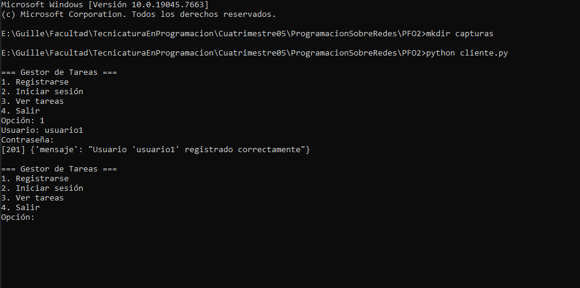
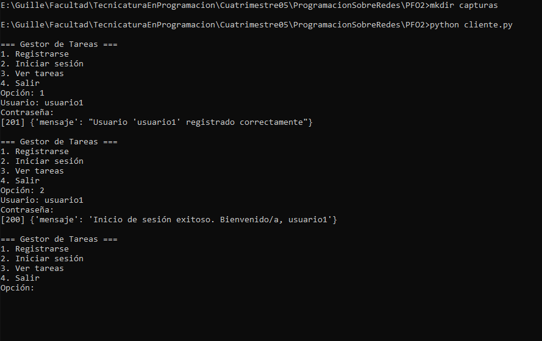
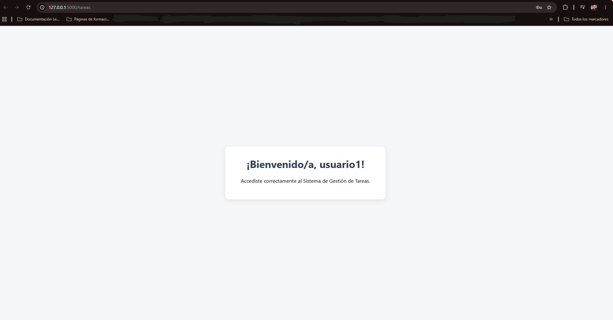
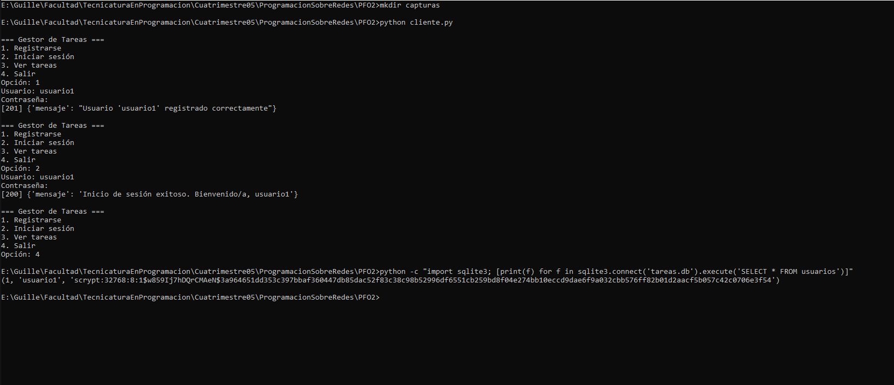

# PFO 2 — Sistema de Gestión de Tareas con API y Base de Datos

**Materia:** Programación sobre Redes — Tecnicatura Superior en Desarrollo de Software
**Alumno:** Guillermo Benítez

API REST desarrollada con **Flask** que permite registrar usuarios, iniciar sesión y acceder a una página de bienvenida protegida. Los datos se guardan en **SQLite** y las contraseñas se almacenan **hasheadas** (nunca en texto plano).

---

## Estructura del proyecto

```
├── servidor.py        # API Flask + SQLite
├── cliente.py         # Cliente de consola que consume la API
├── requirements.txt   # Dependencias
├── docs/index.html    # Página del proyecto (GitHub Pages)
├── capturas/          # Capturas de las pruebas
└── README.md
```

## Endpoints

| Método | Ruta        | Descripción                                   | Respuestas            |
|--------|-------------|-----------------------------------------------|-----------------------|
| POST   | `/registro` | Registra un usuario `{"usuario", "contraseña"}` | 201, 400, 409         |
| POST   | `/login`    | Verifica las credenciales                     | 200, 400, 401         |
| GET    | `/tareas`   | HTML de bienvenida (requiere autenticación)   | 200, 401              |

`/tareas` está protegido con **autenticación HTTP Basic**: el usuario y la contraseña se verifican contra la base de datos en cada petición.

---

## Instalación y ejecución

**Requisitos:** Python 3.8 o superior.

```bash
# 1. Clonar el repositorio
git clone https://github.com/guillermohbenitez/pfo2-gestor-tareas.git
cd pfo2-gestor-tareas

# 2. (Opcional) Crear entorno virtual
python -m venv venv
venv\Scripts\activate        # Windows
source venv/bin/activate     # Linux / macOS

# 3. Instalar dependencias
pip install -r requirements.txt

# 4. Iniciar el servidor
python servidor.py
```

El servidor queda escuchando en `http://127.0.0.1:5000` y crea automáticamente el archivo `tareas.db` la primera vez.

---

## Cómo probarlo

### Opción A — Cliente de consola

En otra terminal (con el servidor corriendo):

```bash
python cliente.py
```

Menú: `1` Registrarse · `2` Iniciar sesión · `3` Ver tareas · `4` Salir.

### Opción B — curl

```bash
# Registro
curl -X POST http://127.0.0.1:5000/registro -H "Content-Type: application/json" -d "{\"usuario\": \"guille\", \"contraseña\": \"1234\"}"

# Login
curl -X POST http://127.0.0.1:5000/login -H "Content-Type: application/json" -d "{\"usuario\": \"guille\", \"contraseña\": \"1234\"}"

# Tareas (con credenciales)
curl -u guille:1234 http://127.0.0.1:5000/tareas
```

### Opción C — Navegador

Entrar a `http://127.0.0.1:5000/tareas`: el navegador pide usuario y contraseña y, si son correctos, muestra la página de bienvenida.

### Resultados esperados

| Prueba                              | Código | Respuesta                                         |
|-------------------------------------|--------|---------------------------------------------------|
| Registro de usuario nuevo           | 201    | `Usuario 'guille' registrado correctamente`       |
| Registro de usuario repetido        | 409    | `El usuario 'guille' ya existe`                   |
| Login correcto                      | 200    | `Inicio de sesión exitoso. Bienvenido/a, guille`  |
| Login con contraseña incorrecta     | 401    | `Usuario o contraseña incorrectos`                |
| `/tareas` sin credenciales          | 401    | `Credenciales inválidas o ausentes`               |
| `/tareas` con credenciales válidas  | 200    | HTML "¡Bienvenido/a, guille!"                     |

---

## Capturas de pantalla

<!-- Reemplazar por tus propias capturas, guardadas en la carpeta capturas/ -->

**Registro exitoso**


**Login exitoso**


**Acceso a /tareas**


**Contraseña hasheada en la base de datos**


---

## Respuestas conceptuales

### ¿Por qué hashear contraseñas?

Porque si la base de datos se filtra (por un ataque, un backup mal guardado o un error humano), quien la obtenga **no puede leer las contraseñas reales**. Un hash es una función de un solo sentido: a partir de la contraseña se obtiene el hash, pero no se puede hacer el camino inverso. Para verificar el login, el servidor vuelve a hashear lo que escribe el usuario y compara los resultados.

Además:
- **Protege a los usuarios en otros sitios:** mucha gente reutiliza contraseñas, así que una filtración en texto plano comprometería también sus otras cuentas.
- **Ni siquiera el administrador conoce las contraseñas**, lo que reduce el riesgo interno.
- **Uso de "sal" (salt):** `werkzeug` agrega un valor aleatorio a cada contraseña antes de hashearla, por lo que dos usuarios con la misma contraseña tienen hashes distintos. Esto inutiliza las *rainbow tables* (tablas de hashes precalculados).
- **Algoritmo lento a propósito:** se usa `scrypt`, diseñado para ser costoso de calcular, lo que hace muy lentos los ataques de fuerza bruta.
- Es una práctica exigida por normas y buenas prácticas de seguridad (OWASP).

### Ventajas de usar SQLite en este proyecto

- **No requiere servidor ni instalación:** viene incluido en Python (módulo `sqlite3`); no hay que instalar ni configurar MySQL o PostgreSQL.
- **Toda la base es un solo archivo** (`tareas.db`), fácil de copiar, mover o borrar para empezar de cero.
- **Persistencia real:** los usuarios se mantienen aunque se reinicie el servidor, a diferencia de guardarlos en una lista en memoria.
- **Usa SQL estándar**, así que lo aprendido sirve para migrar después a un motor más grande.
- **Liviano y rápido** para el volumen de un proyecto educativo o una aplicación pequeña.
- **Soporta restricciones** como `UNIQUE`, que en este proyecto evita usuarios duplicados directamente desde la base.

Como limitación, SQLite no está pensado para muchas escrituras concurrentes ni para que varios servidores accedan a la misma base; para producción a gran escala convendría un motor cliente-servidor.

---

## Nota sobre GitHub Pages

GitHub Pages solo publica sitios **estáticos** (HTML, CSS, JS), por lo que no puede ejecutar el servidor Flask. En Pages se aloja la página de presentación del proyecto (`docs/index.html`), con la documentación y el enlace al código; la API se ejecuta localmente siguiendo las instrucciones de arriba.
